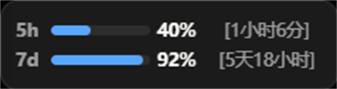
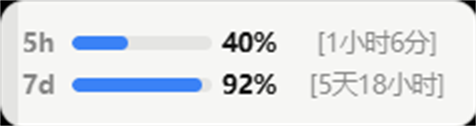
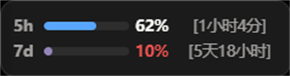

# CodexCapper

Codex 额度桌面组件。用进度条实时显示 Codex 账号每个额度窗口（5 小时 / 每周）的剩余比例和距重置的倒计时，可以悬浮在桌面上，也可以无缝嵌进 Windows 任务栏，一眼看到额度还剩多少。

数据不走任何第三方服务器：直接读取本机 `~/.codex` 的会话与凭证，并在本地拉起 `codex` CLI 查询官方额度接口，全程无网络服务、无账号体系、无遥测。首次启动即嵌在任务栏右端，像原生任务栏小工具一样常驻。

| | |
|:---:|:---:|
|  |  |
| 深色主题 | 浅色主题（也可跟随系统自动切换） |


紧凑模式：只显示最紧张的那个窗口，单行显示，几乎不占空间。



额度吃紧时（示例中 7d 仅剩 10%），剩余百分比与进度条都会变红以示警告。

## 特性

- **全部额度窗口**：5 小时窗口与每周窗口各占一行，显示剩余百分比进度条、剩余额度颜色和重置倒计时；额度越低颜色越醒目，官方数据与本机估算数据以「估」角标区分
- **两种摆放方式**
  - **悬浮**：无边框圆角小窗，可拖动，默认贴在屏幕右下角
  - **固定到任务栏**（仅 Windows）：嵌入任务栏，靠左端（开始按钮侧）或靠右端（托盘图标侧），像原生任务栏小工具一样不抢焦点
- **托盘图标即状态灯**：按最紧张窗口的使用率变色——绿色正常、琥珀色（≥70%）提醒、红色（≥90%）告急，不用点开就能看出额度是否吃紧
- **全中文托盘菜单**：立即刷新、强制重启、显示组件、刷新频率（1/3/5/15 分钟）、位置、显示器、外观（主题 / 紧凑模式 / 鼠标穿透 / 全屏应用时隐藏 / 重置时间样式）、开机自动启动、退出
- **鼠标穿透**：让点击落到组件下面的窗口上，适合把组件当"仪表盘"常驻的场景
- **全屏应用时自动隐藏**：打游戏或演示时不打扰，也不会把独占全屏的游戏挤出全屏
- **回满庆祝**：某个额度窗口重置回满的瞬间，整条进度条会短暂滚动一道彩虹
- **开机自动启动**：走注册表 Run 键，绿色免安装
- **本地化数据源**：只读 `~/.codex`（sessions / auth.json / config.toml），通过本地 `codex` CLI 的 `initialize` 握手获取官方 rate_limits；拿不到官方数据时退化为按本地会话记录估算，并在界面上明确标注

## 下载与安装

前往 [Releases](https://github.com/JDui/CodexCapper/releases) 下载 `CodexCapper-x64-setup.exe` 安装包（当前用户安装，无需管理员权限），或直接下载便携版压缩包，解压后运行 `codexcapper.exe` 即可——单文件、免安装、双击即用。

首次运行后组件默认嵌在任务栏右端、紧贴托盘图标；想改成悬浮窗口，右键系统托盘里的 CodexCapper 图标，在「位置」菜单里切换即可。

### 运行前提

- Windows 10 / 11（Linux 也支持，见下文构建）
- 本机已安装并登录 Codex CLI（`codex login`）。如果装过 ChatGPT 桌面版，组件会自动使用其自带的 codex 二进制，无需单独安装 CLI

## 从源码构建

需要 [Node.js](https://nodejs.org/)（配 pnpm）、[Rust](https://www.rust-lang.org/tools/install) 和 Windows 上的 [Microsoft Visual Studio C++ 生成工具](https://visualstudio.microsoft.com/visual-cpp-build-tools/)：

```sh
# 安装依赖并构建前端（tsc 类型检查 + vite 打包到 dist/）
pnpm install
pnpm run build

# 构建后端（release 编译，产物在 src-tauri/target/release/codexcapper.exe）
cd src-tauri
cargo build --release
```

前端资源内嵌进可执行文件，编译出的 `codexcapper.exe` 单文件即可运行。

日常开发热更新：

```sh
pnpm run app:dev
```

## 配置

配置保存在 `%APPDATA%\CodexCapper\settings.json`（Linux 为 `~/.config/CodexCapper/`），一般无需手改，托盘菜单里的选项都会即时写入。常用项：

| 配置 | 说明 |
|---|---|
| 刷新频率 | 官方额度查询间隔，1 / 3 / 5 / 15 分钟 |
| 位置 | 悬浮 / 固定到任务栏（靠左端或靠右端） |
| 显示器 | 多显示器时指定组件在哪块屏上 |
| 主题 | 跟随系统 / 深色 / 浅色 |
| 紧凑模式 | 单行显示最紧张的窗口 |
| 鼠标穿透 | 点击穿过组件 |
| 全屏应用时隐藏 | 检测到全屏应用时收起 |
| 重置时间 | 倒计时（如 `[1小时6分]`）或绝对时间样式 |
| 开机自动启动 | 注册表 Run 键，免管理员权限 |

调试模式：用 `codexcapper.exe --demo` 启动可展示演示数据，不读取真实账号。

## 开发说明

- 前端：React + TypeScript + Vite + Tailwind CSS
- 后端：Rust + Tauri v2，托盘、任务栏嵌入、全屏检测均为原生实现
- 测试：`cargo test --lib`（Rust 侧单元测试）
- `scripts/` 下有文档截图的重拍脚本

## 许可

[GPL-3.0-or-later](LICENSE)
